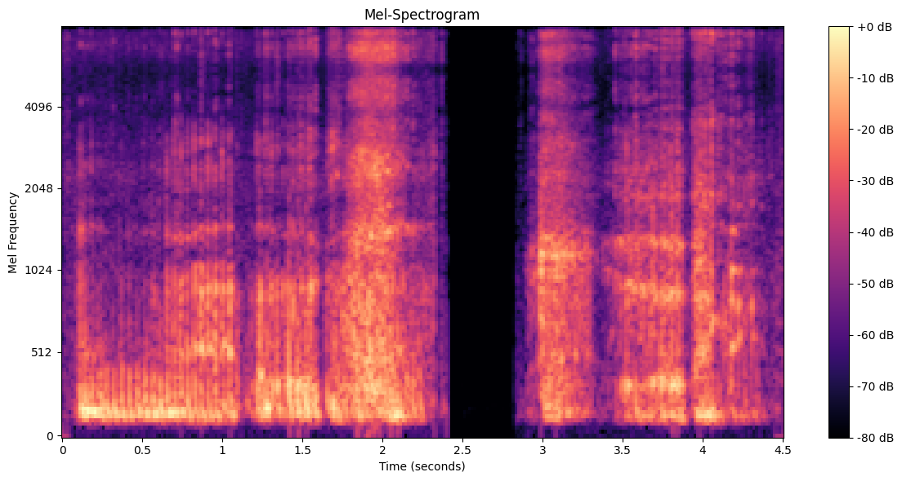
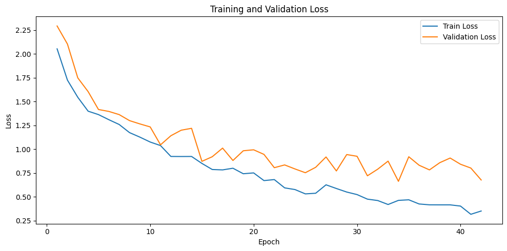
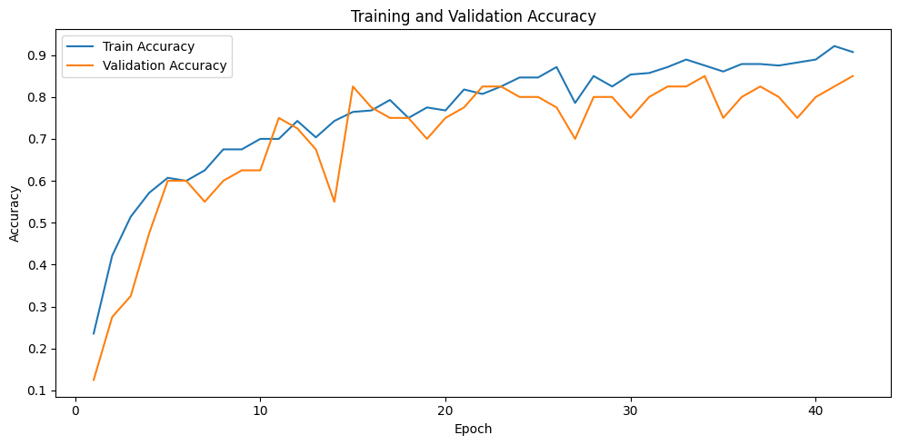
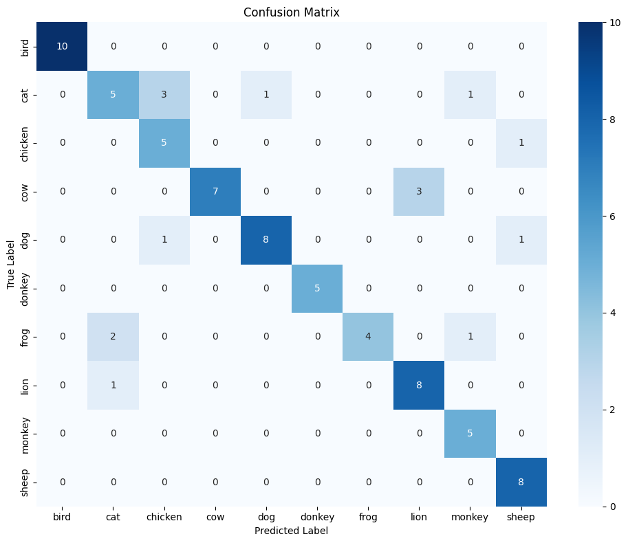

# Klasifikasi Suara Hewan dengan 1D CNN

Proyek ini berisi analisis dan klasifikasi rekaman suara hewan menggunakan **Convolutional Neural Network 1D (1D CNN)**. Seluruh eksperimen utama terdokumentasi di [`1d.ipynb`](1d.ipynb), dari pemeriksaan dataset sampai evaluasi model.

## Tujuan

Membangun model yang memprediksi kelas hewan dari bentuk gelombang audio mentah. Notebook juga mengeksplorasi fitur domain waktu dan frekuensi untuk memahami karakteristik sinyal sebelum melatih model.

## Dataset

Notebook memuat dataset [`APEX-SUPERB/animal_classification`](https://huggingface.co/datasets/APEX-SUPERB/animal_classification) melalui Hugging Face Datasets. Output yang tersimpan menunjukkan **400 rekaman**, dengan kolom audio, nama file, instruksi, dan label. Eksperimen mencakup 10 kelas: bird, cat, chicken, cow, dog, donkey, frog, lion, monkey, dan sheep.

> **Catatan pembagian data:** dataset sumber yang dimuat notebook hanya menyediakan split bernama `test`. Notebook kemudian membagi 400 rekaman dari split tersebut secara stratifikasi menjadi train (70%), validation (10%), dan test (20%). Karena itu, angka test di bawah adalah hasil dari pembagian internal ini, bukan evaluasi pada test set resmi yang terpisah dari dataset.

## Alur Kode

1. **Persiapan dan pemeriksaan data** — mengimpor pustaka, menetapkan seed `42`, memuat dataset, mengidentifikasi kolom audio/label, serta memeriksa distribusi kelas.
2. **Prapemrosesan audio** — membaca audio dari bytes atau file, mengubah stereo menjadi mono, melewati sampel yang gagal dibaca, mengubah sampling rate menjadi 16 kHz, dan melakukan peak normalization.
3. **Eksplorasi fitur** — menghitung statistik domain waktu (misalnya RMS, energi, zero-crossing rate), fitur spektral (misalnya spectral centroid dan bandwidth), serta representasi STFT, Mel-spectrogram, dan MFCC. Notebook menggabungkan fitur statistik, membaginya, menstandarkan fitur, dan memvisualisasikan dua komponen PCA.
4. **Persiapan masukan CNN** — menggunakan kembali gelombang audio yang telah diproses, bukan tabel fitur tadi. Tiap rekaman dipotong atau diberi zero-padding hingga 3 detik pada 16 kHz, yaitu 48.000 sampel.
5. **Pelatihan 1D CNN** — membentuk dataset dan DataLoader PyTorch, melatih model dengan loss cross-entropy dan optimizer Adam, lalu menyimpan bobot dengan validation loss terbaik. Early stopping menghentikan pelatihan bila validation loss tidak membaik selama 8 epoch.
6. **Evaluasi dan kompleksitas** — mengukur accuracy, macro precision/recall/F1, ROC-AUC multiclass, classification report, confusion matrix, jumlah parameter, operasi komputasi, dan waktu inferensi.

### Arsitektur Model

Model menerima tensor berbentuk `(batch, 1, 48000)`. Bagian ekstraksi fitur terdiri dari empat blok `Conv1d` dengan 32, 64, 128, dan 256 channel. Setiap blok menggunakan batch normalization dan ReLU; tiga blok awal juga menggunakan max pooling. Adaptive average pooling merangkum urutan waktu, kemudian dropout 0,3 dan fully connected layer menghasilkan skor untuk 10 kelas.

Konfigurasi utama yang tercatat: batch size 16, maksimum 50 epoch, learning rate `0.001`, weight decay `0.0001`, dan seed 42.

## Hasil Tersimpan

Berikut visualisasi diekstrak dari output yang sudah tersimpan di notebook. Angka evaluasi berasal dari output notebook tersebut; notebook tidak dijalankan ulang saat README ini dibuat.

| Metrik pada test internal (80 sampel) | Skor |
| --- | ---: |
| Accuracy | 81,25% |
| Macro precision | 83,11% |
| Macro recall | 82,94% |
| Macro F1 | 81,37% |
| Macro ROC-AUC (OvR) | 97,20% |



*Mel-spectrogram contoh audio setelah prapemrosesan.*



*Perubahan loss pada data train dan validation selama pelatihan.*



*Perubahan akurasi pada data train dan validation selama pelatihan.*



*Confusion matrix untuk 80 sampel test internal.*

Classification report tersimpan menunjukkan hasil per kelas yang bervariasi; misalnya recall cat sebesar 0,50 dan frog sebesar 0,57. Macro ROC-AUC yang tinggi tidak berarti semua label terklasifikasi dengan sama baiknya, sehingga confusion matrix dan metrik per kelas tetap penting.

Output kompleksitas yang tersimpan mencatat 157.898 parameter, ukuran bobot FP32 sekitar 0,62 MB, sekitar 197,09 juta MACs, dan waktu inferensi sekitar 34,56 ms per sampel. Waktu inferensi bergantung pada perangkat dan lingkungan runtime.

## Menjalankan Notebook

Gunakan Python dengan Jupyter Notebook atau Google Colab, lalu jalankan sel secara berurutan. Akses internet diperlukan untuk mengunduh dataset dan paket yang belum terpasang. GPU CUDA dapat digunakan bila tersedia; notebook memilih perangkat secara otomatis.

Paket yang digunakan:

```bash
pip install datasets librosa soundfile scipy scikit-learn seaborn matplotlib pandas torch torchaudio thop
```

Notebook memakai magic `%pip` untuk instalasi paket dari dalam kernel. File bobot model (`best_animal_audio_cnn.pth` dan `animal_audio_cnn_fp32.pth`) dibuat saat notebook dijalankan dan tidak termasuk aset hasil yang diekstrak untuk README ini.

## Struktur Folder

```text
1-dimensional-data/
├── 1d.ipynb
├── README.md
└── assets/
    ├── confusion-matrix.png
    ├── mel-spectrogram.png
    ├── training-accuracy.png
    └── training-loss.png
```
